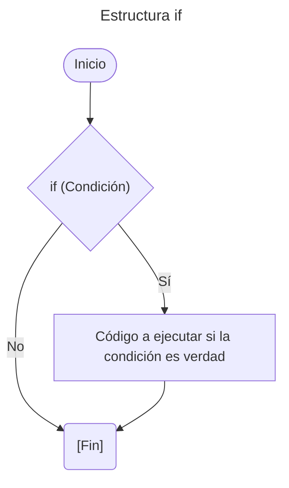
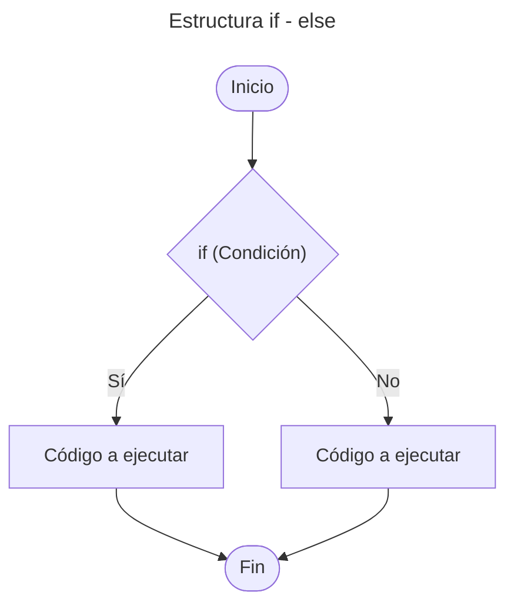
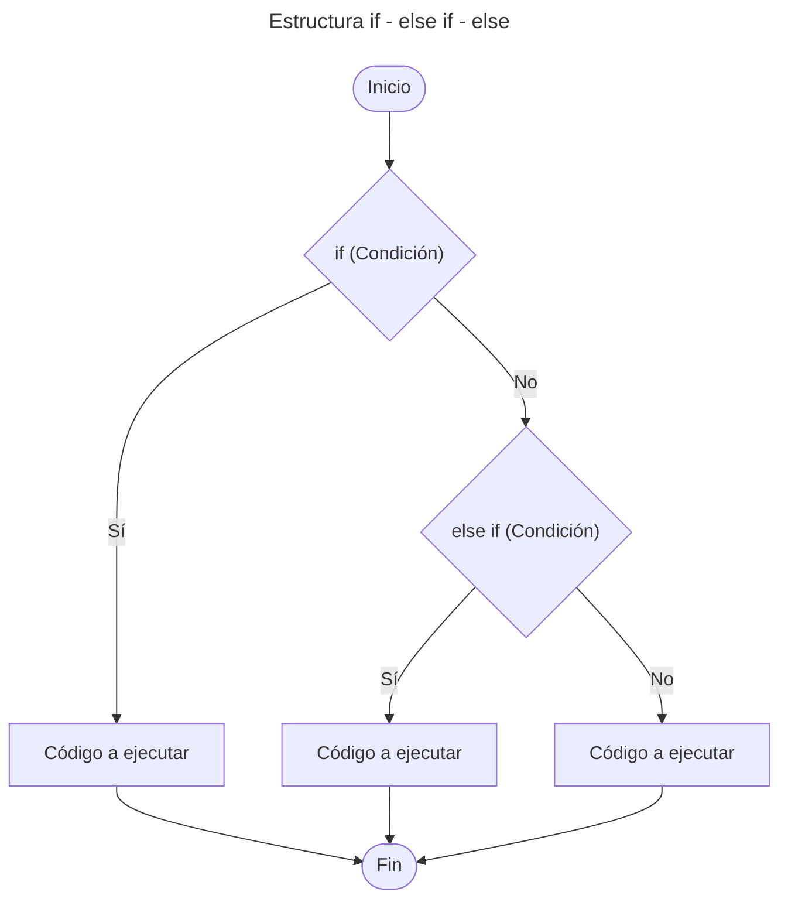

# 4. Estructuras de Control

Nos permite controlar el flujo de ejecución de un programa.

---

## Tabla de Contenido

- [4. Estructuras de Control](#4-estructuras-de-control)
  - [Tabla de Contenido](#tabla-de-contenido)
  - [Estructuras Condicionales](#estructuras-condicionales)
    - [Estructura `if`](#estructura-if)
    - [Estructura `if-else`](#estructura-if-else)
    - [Estructura `if-else if-else`](#estructura-if-else-if-else)
  - [Ejemplo Practico](#ejemplo-practico)

---

## Estructuras Condicionales

Permite ejecutar diferentes bloques de código según se  cumpla o no una determinada condición.

### Estructura `if`

Su función es realizar o no una determinada acción o sentencia, basándose en el resultado de la evaluación de una expresión booleana **(verdadero o falso)**.

***Sintaxis***

```js
if (Condición){
    // Bloque de código a ejecutar si la condición es verdad
}
```

**Diagrama de flujo:**



### Estructura `if-else`

La estructura selectiva doble ``if - else`` permite toma de decisión. Si la condición es **verdadera**, entonces se sigue por un camino específico y se ejecuta una acción determinada. Por otra parte, si el resultado de la evaluación es **falso**, entonces se sigue por otro camino y se realiza otra acción. En ambos casos, luego de ejecutar las acciones correspondientes, se continúa con la secuencia normal del diagrama de flujo.

***Sintaxis***

```js
if (Condición){
    // Bloque de código a ejecutar si la condición es verdad
}
else{
    // Bloque de código a ejecutar si la condición es falsa
    }
```

**Diagrama de flujo:**



### Estructura `if-else if-else`

Permite establecer una serie de condiciones al interior del programa, que ayuda a determinar qué acciones llevar a cabo dadas ciertas circunstancias. La sentencia ``else if`` se usa cuando deseamos evaluar múltiples condiciones.

***Sintaxis***

```js
if (Condición){
    // Bloque de código a ejecutar si la condición es verdad
}
else if (Condición){
    // Bloque de código a ejecutar si if es falso y la condición es verdad
}
else{
    // Bloque de código a ejecutar si todas las condiciones son falsa
}
```

**Diagrama de flujo:**



---

## Ejemplo Practico

1. *Estructuras Condicionales*
   1. [Estructura `if`](/01_Fundamentos/04_Estructuras_de_Control/02_Estructura_if.js)
   2. [Estructura `if-else if-else`](/01_Fundamentos/04_Estructuras_de_Control/03_Estructura_if-else-if_else.js)

---

[Inicio](#5-estructuras-de-control)

---

[Tabla de contenido principal](/Tabla_Contenido.md)

---
