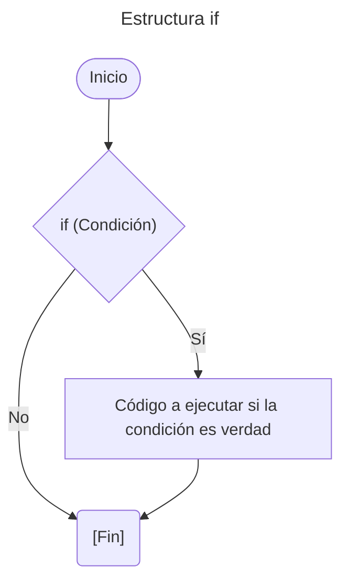
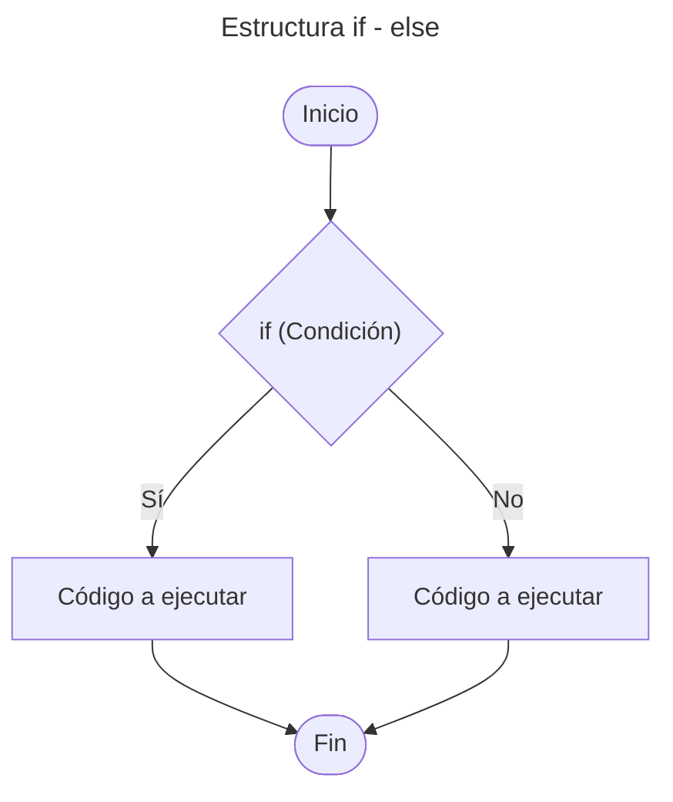
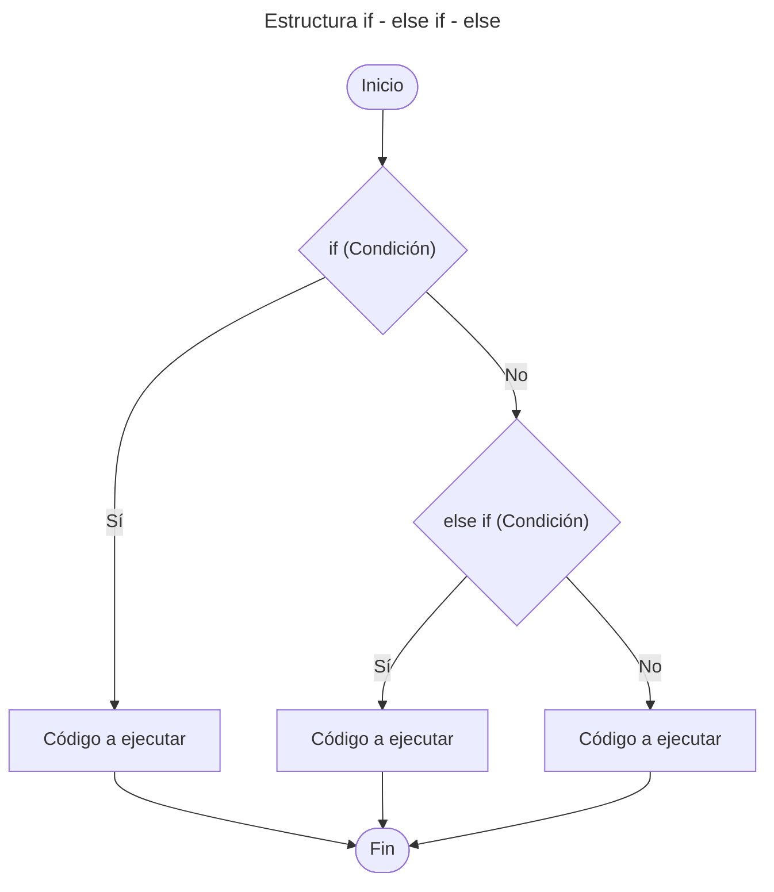
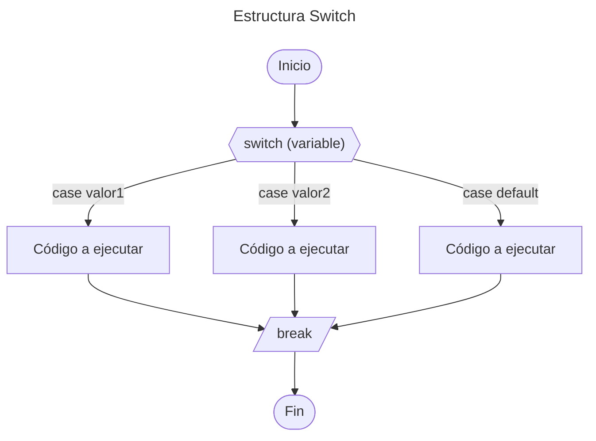
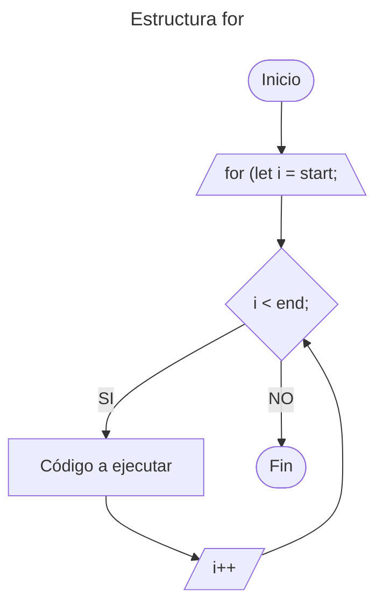
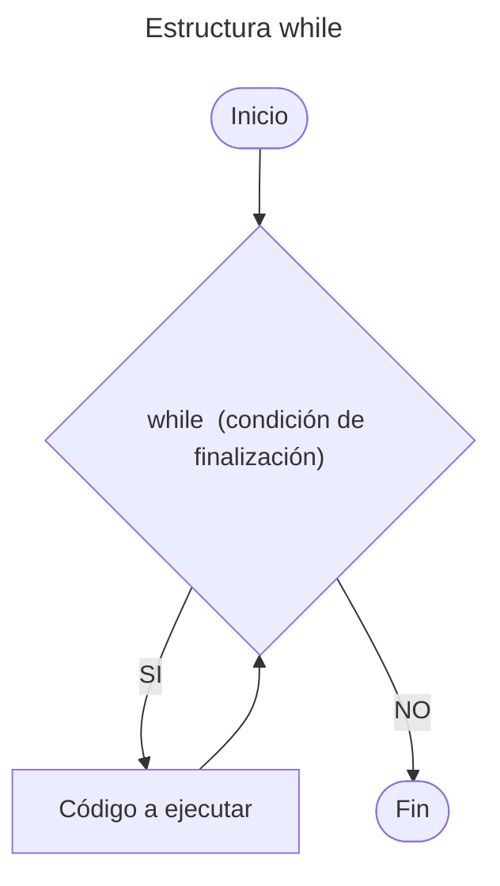

# 4. Estructuras de Control

Nos permite controlar el flujo de ejecución de un programa.

---

## Tabla de Contenido

- [4. Estructuras de Control](#4-estructuras-de-control)
  - [Tabla de Contenido](#tabla-de-contenido)
  - [Estructuras Condicionales](#estructuras-condicionales)
    - [Estructura `if`](#estructura-if)
    - [Estructura `if-else`](#estructura-if-else)
    - [Estructura `if-else if-else`](#estructura-if-else-if-else)
    - [Condicionales Anidados](#condicionales-anidados)
    - [Estructura Switch](#estructura-switch)
  - [Estructura Bucle / loop](#estructura-bucle--loop)
    - [Estructura `for`](#estructura-for)
    - [Estructura `while`](#estructura-while)
  - [Ejemplo Practico](#ejemplo-practico)

---

## Estructuras Condicionales

Permite ejecutar diferentes bloques de código según se  cumpla o no una determinada condición.

### Estructura `if`

Su función es realizar o no una determinada acción o sentencia, basándose en el resultado de la evaluación de una expresión booleana **(verdadero o falso)**.

***Sintaxis***

```js
if (Condición){
    // Bloque de código a ejecutar si la condición es verdad
}
```

**Diagrama de flujo:**



### Estructura `if-else`

La estructura selectiva doble ``if - else`` permite toma de decisión. Si la condición es **verdadera**, entonces se sigue por un camino específico y se ejecuta una acción determinada. Por otra parte, si el resultado de la evaluación es **falso**, entonces se sigue por otro camino y se realiza otra acción. En ambos casos, luego de ejecutar las acciones correspondientes, se continúa con la secuencia normal del diagrama de flujo.

***Sintaxis***

```js
if (Condición){
    // Bloque de código a ejecutar si la condición es verdad
}
else{
    // Bloque de código a ejecutar si la condición es falsa
    }
```

**Diagrama de flujo:**



### Estructura `if-else if-else`

Permite establecer una serie de condiciones al interior del programa, que ayuda a determinar qué acciones llevar a cabo dadas ciertas circunstancias. La sentencia ``else if`` se usa cuando deseamos evaluar múltiples condiciones.

***Sintaxis***

```js
if (Condición){
    // Bloque de código a ejecutar si la condición es verdad
}
else if (Condición){
    // Bloque de código a ejecutar si if es falso y la condición es verdad
}
else{
    // Bloque de código a ejecutar si todas las condiciones son falsa
}
```

**Diagrama de flujo:**



### Condicionales Anidados

Podemos colocar sentencias `if / else if / else` dentro de otras sentencias `if`. Esto se llama anidamiento, y nos permite verificar condiciones en pasos. (*jerárquicas*)
Las estructuras anidadas pueden ser tan profundas como sea necesario.

***Sintaxis Básica***

```js
if (condition1) {
    if (condition2) {
        if (condition3) {
            // Todas las condiciones son verdaderas
        }
    }
}
```

> [!TIP]
> Usa el anidamiento cuando cada comprobación dependa de que la anterior sea verdadera.

### Estructura Switch

Los condicionales Switch, son una estructura de control condicional, que permite definir múltiples casos que puede llegar a cumplir una variable, y qué acción tomar en cualquiera de estas situaciones, incluso es posible determinar qué acción llevar a cabo en caso de no cumplir ninguna de las condiciones dadas.

```js
switch (variable) {
    case valor1:
        // Código a ejecutar si variable es igual a value1
        break;
    case valor2:
        // Código a ejecutar si variable es igual a value2
        break;
    default:
        // Código a ejecutar si ningún caso coincide
}
```

*Componentes clave:*

- `case`: representa un posible valor de la variable
- `break`: sale de `switch` después de ejecutar un `case` (evita la ejecución sucesiva)
- `default`: `case` opcional que se ejecuta si ningún otro `case` coincide

**Diagrama de flujo:**



---

## Estructura Bucle / loop

Los bucles permiten repetir un bloque de código n veces

### Estructura `for`

El bucle for permite repetir el código varias veces.

***Sintaxis:***

```js
for (let i = start; i < end; i++) {
    //Código a ejecutar
}
```

*Componentes clave:*

- `let i = start`: Establece el valor inicial de `i`
- `i < end`: Condición para que el bucle continúe
- `i++`: Incrementa `i` después de cada iteración

**Diagrama de flujo:**



### Estructura `while`

Permite repetir un conjunto de interacciones. Sin embargo, **el número de veces** que se debe repetir **depende de la condición de finalización**. Cada vez que **inicia el ciclo se evalúa una condición**, si ésta es *verdadera* se continúa con la ejecución, de otra forma se detiene.

> [!WARNING]
> **Dentro** del ciclo **siempre debe existir un enunciado que afecte la condición**, de tal forma que aquél no se repita de manera infinita.

***Sintaxis***

```cpp
while (condición de finalización) { 
    //Código a ejecutar
}
```

**Diagrama de flujo:**



---

## Ejemplo Practico

1. *Estructuras Condicionales*
   1. [Estructura `if`](/01_Fundamentos/05_Estructuras_de_Control/02_Estructura_if.js)
   2. [Estructura `if-else if-else`](/01_Fundamentos/05_Estructuras_de_Control/03_Estructura_if-else-if_else.js)
   3. [Condicionales Anidados](/01_Fundamentos/05_Estructuras_de_Control/04_Condicionales_Anidados.js)
   4. [Estructura `switch`](/01_Fundamentos/05_Estructuras_de_Control/05_Estructura%20Switch.js)
2. *Estructuras Bucle/loop*
   1. [Estructura `for`](/01_Fundamentos/05_Estructuras_de_Control/06_Estructura_For.js)

---

[Inicio](#4-estructuras-de-control)

---

[Tabla de contenido principal](/Tabla_Contenido.md)

---
